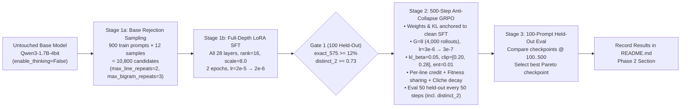

# Plan: Clean From-Scratch Non-Thinking (Direct) SFT → GRPO

## Goal

Start cleanly from the **untouched base model** (`mlx-community/Qwen3-1.7B-4bit`, `enable_thinking=False`, zero `<think>` or `<haiku>` tags) with **every Phase 1 lesson active from Step 1**, targeting **`55%–70%+` exact 5-7-5 accuracy** on the 100 unseen held-out topics in [`data/eval.jsonl`](../data/eval.jsonl) while maintaining strong poetic diversity (**`distinct_2 >= 0.68`**, `unique_haiku_ratio >= 98%`, `mean_relevance_sim >= 0.68`, `oov_rate <= 2%`, `echo_rate <= 1%`) on a **16GB Apple M5 MacBook Pro**.

---

## What Changed From Phase 1

| Phase 1 Bottleneck | Root Cause | Clean From-Scratch Direct Fix |
| :--- | :--- | :--- |
| **Template collapse (`"Nightfall claims..."`, `distinct_2 = 0.357`)** | Narrow 16-layer `rank=8` LoRA favored 1 reusable frame; re-anchoring KL to previous GRPO runs created a KL ratchet; anti-collapse penalties started *after* `cl = 100%`. | **Full-depth LoRA (`lora_layers = -1` [all 28 layers], `rank = 16`, `scale = 8.0`)** + **uncollapsed base-only rejection sampling** + **KL permanently anchored to initial clean SFT** + **fitness sharing + starter/word/bigram jackpot decay + DAPO Clip-Higher (`0.28`) + entropy bonus (`0.01`) active from Step 1**. |
| **Slow Line 2 learning** | Sequence-level scalar advantages penalized exact lines inside near-miss haikus. | **Per-line token credit assignment** (`line_credit_weight = 0.50`) active from Step 1. |
| **Theme out-voting syllables among near-misses** | `0.40` theme swing exceeded `+0.18` exact-line gain; `0.52` similarity floor robbed poetic indirect haikus. | **Syllable-first reward geometry** (`line_max = 0.60`, `slope = 0.55`, `exact_575_bonus = 2.50`, `relevance_weight = 0.20`, `exact_bonus_min_sim = 0.42`). |
| **Late-run oscillation & blind diversity tracking** | Constant LR bounced after peak; mid-run eval snapshots didn't show `distinct_2`. | **Cosine LR decay** (`3e-6 → 3e-7`) + **live `eval_distinct_2` & `eval_unique_ratio`** logged on 50 held-out prompts every 50 steps. |

---

## Pipeline Architecture

---

## Stage-by-Stage Specification

### Stage 1: Clean Base Rejection-Sampling SFT (`direct_clean_sft`)
- **Sampling source:** Untouched `mlx-community/Qwen3-1.7B-4bit` (no adapter — zero carryover from Phase 1 runs).
- **Candidate budget:** All `900` training prompts × `12` samples = `10,800` candidates (`temp = 0.95`, `top_p = 0.95`, `max_tokens = 64`), strictly filtered by `is_sft_worthy` + `max_line_repeats = 2` + `max_bigram_repeats = 3`.
- **Expected yield:** ~250–350 completely fresh, zero-OOV, on-topic exact 5-7-5 haikus (`runs/direct_clean_sft/sft_haikus.jsonl`).
- **LoRA SFT:** `lora_layers = -1` (all 28 layers, attention `q/k/v/o_proj` + MLP `gate/up/down_proj`), `lora_rank = 16`, `lora_scale = 8.0`, `2 epochs`, `lr = 2e-5 → 2e-6` cosine decay, `grad_accum = 4`, `grad_checkpoint = True`.
- **Gate 1 (100 held-out eval):** Verify `exact_575 >= 12%`, `distinct_2 >= 0.73`, and `mean_relevance_sim >= 0.70` before launching Stage 2.

### Stage 2: 500-Step Anti-Collapse GRPO (`direct_clean_grpo`)
- **Initial weights:** `--resume-adapter runs/direct_clean_sft/adapters/final`
- **KL reference anchor:** `--kl-ref-adapter runs/direct_clean_sft/adapters/final` (permanently locked — no KL ratchet).
- **Rollouts & optimization:**
  - `steps = 500`, `group_size = 8` (`4,000` rollouts total)
  - `lr = 3e-6 → 3e-7` cosine decay
  - `kl_beta = 0.05`
  - `clip_eps = 0.20`, `clip_eps_high = 0.28` (DAPO Clip-Higher)
  - `entropy_coef = 0.01`
  - `line_credit_weight = 0.50`
  - `fitness_sharing = True` (`jaccard = 0.45`, `exponent = 0.85`)
  - Cross-step `ClicheTracker` (`window = 64`, starter1 `>= 5`, starter2 `>= 3`, bigram `>= 3`, unigram `>= 8`, jackpot decay `0.45x` per hit)
- **Checkpointing & monitoring:** Save LoRA adapters every `50` steps and run a 50-prompt held-out snapshot reporting `eval_exact_575`, `eval_distinct_2`, `eval_unique_ratio`, `eval_relevance`, and `eval_oov_rate`.

### Stage 3: Held-Out Evaluation & Pareto Selection
- Evaluate top checkpoints (`step_0200`, `step_0300`, `step_0400`, `final`) on all `100` held-out prompts in `data/eval.jsonl` against `runs/baseline_direct_eval.json`.
- Select the best Pareto checkpoint maximizing `exact_575_rate` subject to `distinct_2 >= 0.68`, `unique_haiku_ratio >= 98%`, and `mean_relevance_sim >= 0.68`.
- Record final metrics and representative unseen haikus in the **Phase 2** table of [`README.md`](../README.md).

---

## Memory & Runtime Budget (16GB M5, `caffeinate -i`)

| Stage | Est. Peak Metal RAM | Est. Wall Time |
| :--- | :---: | :---: |
| Stage 1a — Base rejection sampling (`10,800` candidates) | ~2.0 GB | ~22–28 min |
| Stage 1b — Full-depth LoRA SFT (`all 28 layers, r=16`) | ~5.5–6.5 GB | ~4–5 min |
| Stage 2 — 500-step GRPO (`G=8`, full-depth LoRA) | ~3.5–4.5 GB | ~50–60 min |
| Stage 3 — 100-prompt held-out eval per checkpoint | ~2.0 GB | ~14s each |
