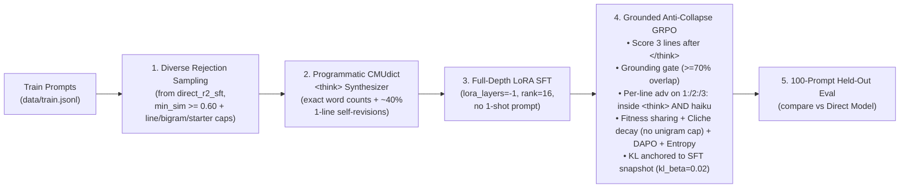

# Plan: Grounded `<think>` SFT → GRPO for High-Accuracy Creative Haikus

## Goal

Achieve **`75%–90%+` exact 5-7-5 accuracy** on the 100 held-out topics in [`data/eval.jsonl`](../data/eval.jsonl) while maintaining rich, varied poetry (**`distinct_2 >= 0.70`**, `unique_haiku_ratio >= 98%`, `mean_relevance_sim >= 0.68`) on a **16GB Apple M5 MacBook Pro**, without re-introducing any of the `<think>` failure modes from Run 1.

This mode will be opt-in (`--thinking-mode`) so direct-generation mode stays 100% intact for clean apples-to-apples comparisons.

---

## Why Run 1 `<think>` Failed vs. How This Design Fixes It

| Run 1 Failure Mode | Root Cause | Grounded `<think>` Fix |
| :--- | :--- | :--- |
| **800+ token rambling & truncation (`[skip:0var]`)** | Qwen3's native `enable_thinking=True` triggers verbose math-CoT prose. | Cold-start SFT with **programmatically synthesized ~75–120 token CMUdict traces** (`enable_thinking=False` + explicit `<think>` format); cap `max_completion_tokens = 224` so 2–3 line self-revisions never truncate. |
| **Fake `<think>` copy hack** | Concrete 1-shot autumn-leaves poem in prompt + `+0.30` free tag reward + unverified `<think>` body. | **No 1-shot poem in prompt**, **zero positive tag reward**, and a deterministic **grounding check** requiring `>= 70%` of the final haiku's content words to appear inside `<think>` (plus `think_count_accuracy` diagnostic in eval). |
| **Template collapse (`"Nightfall claims the [X]"`)** | Limited LoRA depth (`16/28` layers, `r=8`), shifting KL anchor, symmetric clipping. | **Full-depth LoRA (`lora_layers=-1`, `rank=16`)** + Track A R2 anti-collapse guardrails (`fitness_sharing`, starter1/starter2/bigram `cliche_jackpot_decay` with **unigram cap disabled**, DAPO `clip_eps_high=0.28`, `entropy_coef=0.005`, `kl_beta=0.02` anchored to diverse SFT). |

---

## Output Format (No `<haiku>` Tags, Zero Tag-Farming Bonus)

The model emits a tight `<think>...</think>` scratchpad and then outputs the **final 3-line haiku directly after `</think>`**:

```xml
<think>
1: Frost(1) bites(1) cold(1) air(1) = 4 -> Frost(1) bites(1) the(1) cold(1) air(1) = 5
2: Soft(1) snowflakes(2) drift(1) to(1) the(1) ground(1) = 7
3: Dawn(1) breaks(1) pale(1) and(1) still(1) = 5
</think>
Frost bites the cold air
Soft snowflakes drift to the ground
Dawn breaks pale and still
```

- **Typical length:** ~85–125 tokens total (`max_completion_tokens = 224` so multi-line self-revisions never truncate; generation stops early at EOS).
- **Exact surface words:** No invented hyphenation (`snowflakes(2)`, not `snow-flakes(2)`) so CMUdict counts and grounding match verbatim.
- **Inference UX:** [`src/grpo_haiku/generate.py`](../src/grpo_haiku/generate.py) strips `<think>...</think>` for clean display by default, with a `--show-think` flag to inspect live counting & self-revisions.

---

## Architecture & Training Pipeline



---

## Detailed Component Plan

### 1. Configuration ([`src/grpo_haiku/config.py`](../src/grpo_haiku/config.py))
- Add `thinking_mode: bool = False` (or pass via `GRPOConfig` / `RewardConfig`).
- Add grounding guardrail fields to `RewardConfig`:
  - `grounding_min_overlap: float = 0.70` (fraction of final haiku content words that must appear in `<think>`)
  - `ungrounded_think_penalty: float = -0.35` (plus forfeits `exact_575_bonus`)
  - `missing_think_penalty: float = -0.50`
- Recommended `ModelConfig` overrides for the clean `<think>` run:
  - `lora_layers = -1` (all 28 layers on 1.7B, all 36 on 4B)
  - `lora_rank = 16`, `lora_scale = 8.0`
- Recommended `GRPOConfig` overrides for `<think>` mode:
  - `max_completion_tokens = 224` (headroom for 2–3 line self-revisions without truncation)
  - `group_size = 8`, `num_steps = 300–400`
  - `learning_rate = 3e-6`, `min_learning_rate = 5e-7`, `kl_beta = 0.02`
  - `exact_bonus_min_sim = 0.48` (tightened from `0.42` to keep relevance >= 0.68)
  - `cliche_unigram_min_count = 0` (disabled per Track A R2 finding; keep starter1/starter2/bigram + fitness sharing)
  - `clip_eps = 0.2`, `clip_eps_high = 0.28`, `entropy_coef = 0.005`

---

### 2. Prompting ([`src/grpo_haiku/data.py`](../src/grpo_haiku/data.py))
- Add `THINK_SYSTEM_PROMPT` (no concrete 1-shot poem to copy!):
  ```text
  You are a skilled haiku poet. First, briefly count each word's syllables inside
  <think>...</think> (format: `1: word(n) ... = 5`, revising any line that is not
  5, 7, or 5). Immediately after </think>, output ONLY the final 3-line English
  haiku (no title, no tags, no extra text). Use standard English words and avoid
  cliches or copying the prompt verbatim.
  ```
- Extend `format_chat_prompt(tokenizer, user_prompt, thinking_mode=False)`:
  - When `thinking_mode=True`, still call `apply_chat_template(..., enable_thinking=False)` and strip any trailing empty `<think>\n\n</think>\n\n` suffix (so Qwen3 does **not** enter its 1,000-token math-CoT persona), ending cleanly at `<|im_start|>assistant\n`—or optionally prefilling `<think>\n1:` if needed (testing without prefill first since SFT teaches `<think>\n1:` natively!).

---

### 3. Programmatic CMUdict `<think>` Synthesizer ([`src/grpo_haiku/sft.py`](../src/grpo_haiku/sft.py))
Create `synthesize_think_trace(haiku_lines, draft_miss_line=None, rng=None) -> str`:
1. For each line `i in (1, 2, 3)` with target `t in (5, 7, 5)`:
   - Use `analyze_line` / `lookup_word_syllables` from [`src/grpo_haiku/syllables.py`](../src/grpo_haiku/syllables.py) to select the exact valid syllable count `c_w` per word that sums to `t` (using a tiny backtracking search over `word_counts` for multi-pronunciation words like `"fire"`).
   - Format cleanly as:
     `1: Frost(1) bites(1) the(1) cold(1) air(1) = 5`
2. **Self-revision augmentation (~40% of SFT examples):**
   - Pick one line `k` (weighted toward Line 2 since 7 syllables is hardest).
   - Either use a **real near-miss line** collected from another rollout of the *same prompt* during rejection sampling (off by ±1–2 syllables, zero OOV) **or** deterministically perturb one word (e.g., drop a 1-syllable article/adjective) to form an off-by-1 draft:
     `2: Soft(1) snowflakes(2) drift(1) to(1) ground(1) = 6 -> Soft(1) snowflakes(2) drift(1) to(1) the(1) ground(1) = 7`
   - This explicitly teaches the model the exact token pattern for **spotting an off-by-1 sum and fixing it** before closing `</think>`.
3. Assemble full SFT target:
   ```text
   <think>
   {line_1_trace}
   {line_2_trace}
   {line_3_trace}
   </think>
   {haiku_line_1}
   {haiku_line_2}
   {haiku_line_3}
   ```
4. **Diversity-first SFT dataset (~450–550 examples):**
   - Sample from **`runs/direct_r2_sft/adapters/final`** (`50%` exact, `distinct_2 = 0.728`, `rel = 0.665`, no GRPO starter drift) with strict filters (`--min-sim 0.60`, `--max-starter-repeats 8`, `--max-line-repeats 2`, `--max-bigram-repeats 2`) so `<think>` SFT starts with `distinct_2 >= 0.74` and `mean_relevance_sim >= 0.70`, while reusing real off-by-1/2 near-miss lines from the same prompt's rollouts for genuine self-revision traces.
   - Train 2 epochs of full-depth LoRA SFT from untouched base weights (`lora_layers=-1`, `rank=16`, `lr=2.5e-5` with cosine decay, prompt tokens masked out).

---

### 4. Grounded Parsing & Reward Scoring ([`src/grpo_haiku/rewards.py`](../src/grpo_haiku/rewards.py))
- Extend `parse_completion(text, thinking_mode=False)`:
  - When `thinking_mode=True`:
    - Require a single valid `<think>...</think>` block at the start with non-empty interior.
    - Extract everything **after `</think>`** as the candidate haiku and split into non-empty lines.
    - Check `has_digits` **only** on the post-`</think>` haiku text (digits are expected inside `<think>`).
    - Flag `has_stray_tags` if `<haiku>` or extra `<think>` tags appear after `</think>`.
- Add `compute_think_grounding(think_text: str, haiku_lines: tuple[str, ...]) -> float`:
  - Compute the fraction of unique content words in `haiku_lines` (filtering trivial stopwords) that appear in `tokenize_words(think_text)`.
  - If `grounding < cfg.grounding_min_overlap` (`0.70`):
    - Apply `ungrounded_think_penalty` (`-0.35`)
    - **Forfeit `exact_575_bonus`** (`exact_bonus = 0.0`)
  - Result: the model **cannot** write fake boilerplate inside `<think>` and still collect the `+2.50` jackpot.
- Keep **zero positive tag reward** (`format_reward == 0.0` when valid, negative when `<think>` is missing/unclosed or post-`</think>` isn't 3 clean lines).
- All existing syllable, relevance, OOV, repetition, echo, `ClicheTracker`, and `fitness_sharing` logic applies unchanged to the 3 lines after `</think>`.

---

### 5. Credit Assignment for `<think>` + Final Haiku ([`src/grpo_haiku/grpo.py`](../src/grpo_haiku/grpo.py))
- Extend `map_tokens_to_lines(completion_ids, tokenizer, thinking_mode=False)`:
  - Inside `<think>...</think>`, `<think>` / `</think>` tag tokens and unprefixed lines map to `-1` (`A_global`), while numbered drafting lines `1:`, `2:`, `3:` map directly to **`0, 1, 2`** — delivering per-line syllable credit to the exact scratchpad tokens where each line is drafted and revised!
  - Tokens after `</think>` map to `0, 1, 2` (the 3 final haiku lines, identical to direct mode).
- In `compute_per_line_token_advantages`:
  - Tag / unmapped tokens (`line_idx == -1`) receive pure **`A_global[i]`**.
  - Both numbered `<think>` drafting lines and final haiku lines (`line_idx in 0..2`) receive **`(1 - w) * A_global[i] + w * A_line[k][i]`**, preserving razor-sharp per-line syllable credit across both drafting and output!
- Keep `kl_ref_adapter` anchored strictly to the **diverse SFT checkpoint** (never re-anchored to a downstream GRPO run).

---

### 6. Evaluation & Interactive CLI ([`src/grpo_haiku/eval.py`](../src/grpo_haiku/eval.py), [`src/grpo_haiku/generate.py`](../src/grpo_haiku/generate.py))
- Add `--thinking-mode` flag to both `eval.py` and `generate.py` (default `max_tokens=224` when enabled).
- Add `mean_think_grounding`, `mean_think_tokens`, and `think_count_accuracy` (diagnostic verifying whether the `(n)` counts inside `<think>` match CMUdict and sum to `5, 7, 5`) to the `eval.py` summary report so you can verify `<think>` stays concise (~85–120 tokens) and honest (`grounding >= 0.90`).
- In `generate.py`, add `--show-think` to print the `<think>` trace above the verified 3-line haiku breakdown.

---

## Memory & Runtime Budget on 16GB M5

| Model | LoRA Config | `max_tokens` | Est. Peak Metal RAM | Est. Step Time (`G=8`) | 300-Step Wall Time |
| :--- | :---: | :---: | :---: | :---: | :---: |
| **`Qwen3-1.7B-4bit`** *(Start here)* | `layers=-1`, `rank=16` | `224` | **~3.5–4.5 GB** | ~12–16s/step | ~60–80 min |
| **`Qwen3-4B-4bit`** *(Stretch run)* | `layers=-1`, `rank=16` | `224` | **~6.0–7.5 GB** | ~25–35s/step | ~2–3 hrs |

Both stay comfortably inside 16 GB unified memory with zero swap (`grad_checkpoint=True`, micro-batch=1 accumulation, `metal_cache_limit_gb=2.0`, run under `caffeinate -i`).

---

## Verification & Rollout Plan (When Ready to Implement)

### 1. Atomic Commits & Unit Tests (per [`AGENTS.md`](../AGENTS.md))
1. **Commit 1:** Add programmatic CMUdict `<think>` synthesizer + revision generator + unit tests verifying every synthesized line's word-sum equals `(5, 7, 5)` and revisions strictly fix off-by-1 drafts.
2. **Commit 2:** Add `--thinking-mode` parsing + `compute_think_grounding` anti-fake-think gate + unit tests verifying dummy `<think>` boilerplate forfeits the jackpot while honest `<think>` earns full `+4.50`.
3. **Commit 3:** Update `map_tokens_to_lines` & `grpo.py`/`eval.py`/`generate.py` for `--thinking-mode` + unit tests verifying `<think>` tokens get `A_global` while post-`</think>` lines get per-line blended advantages.
4. Verify all unit tests pass (`.venv/bin/pytest -v`).

### 2. End-to-End Experiment Commands (Run with `caffeinate -i`)
```bash
# 1. Synthesize diverse, high-relevance <think> SFT dataset (~450-550 examples) + train full-depth LoRA SFT
caffeinate -i .venv/bin/python -m grpo_haiku.sft \
  --thinking-mode \
  --collect-adapter runs/direct_r2_sft/adapters/final \
  --sft-file runs/think_sft_v1/sft_think_haikus.jsonl \
  --num-prompts 900 --samples-per-prompt 8 \
  --min-sim 0.60 --max-starter-repeats 8 \
  --max-line-repeats 2 --max-bigram-repeats 2 \
  --lora-layers -1 --lora-rank 16 --epochs 2 --lr 2.5e-5 \
  --run-name think_sft_v1

# 2. Evaluate Think-SFT on all 100 held-out prompts
caffeinate -i .venv/bin/python -m grpo_haiku.eval \
  --thinking-mode --max-tokens 224 \
  --eval-file data/eval.jsonl \
  --adapter-path runs/think_sft_v1/adapters/final \
  --out runs/think_sft_v1/eval_sft.json \
  --compare-with runs/baseline_direct_eval.json

# 3. Run Grounded Anti-Collapse Think-GRPO (300 steps, KL anchored to think_sft_v1)
caffeinate -i .venv/bin/python -m grpo_haiku.grpo \
  --thinking-mode --max-tokens 224 \
  --resume-adapter runs/think_sft_v1/adapters/final \
  --kl-ref-adapter runs/think_sft_v1/adapters/final \
  --lora-layers -1 --lora-rank 16 \
  --steps 300 --group-size 8 --temp 0.95 \
  --lr 3e-6 --min-lr 5e-7 --kl-beta 0.02 \
  --exact-min-sim 0.48 --entropy-coef 0.005 \
  --line-credit-weight 0.5 \
  --eval-every 50 --save-every 50 --sample-every 20 \
  --run-name think_grpo_v1

# 4. Final 100-prompt held-out comparison vs Direct model
caffeinate -i .venv/bin/python -m grpo_haiku.eval \
  --thinking-mode --max-tokens 224 \
  --eval-file data/eval.jsonl \
  --adapter-path runs/think_grpo_v1/adapters/final \
  --out runs/think_grpo_v1/eval_final.json \
  --compare-with runs/direct_r2_grpo/eval_step200.json

# 5. Inspect live <think> self-corrections interactively
caffeinate -i .venv/bin/python -m grpo_haiku.generate \
  --thinking-mode --show-think \
  --adapter-path runs/think_grpo_v1/adapters/final \
  --topic "a winter snowy morning"
```

### 3. Success Criteria
- **Exact 5-7-5 (held-out):** `>= 75%` (stretch: `85%+`)
- **Creativity:** `distinct_2 >= 0.70`, `unique_haiku_ratio >= 98%`
- **Honesty:** `mean_think_grounding >= 0.90`, `oov_rate <= 2%`, `echo_rate <= 2%`, `mean_relevance_sim >= 0.68`
- **Stability:** Peak Metal RAM `< 5 GB` on 1.7B (`< 8 GB` on 4B), `kl` steady in `0.03–0.20`, zero swap.
