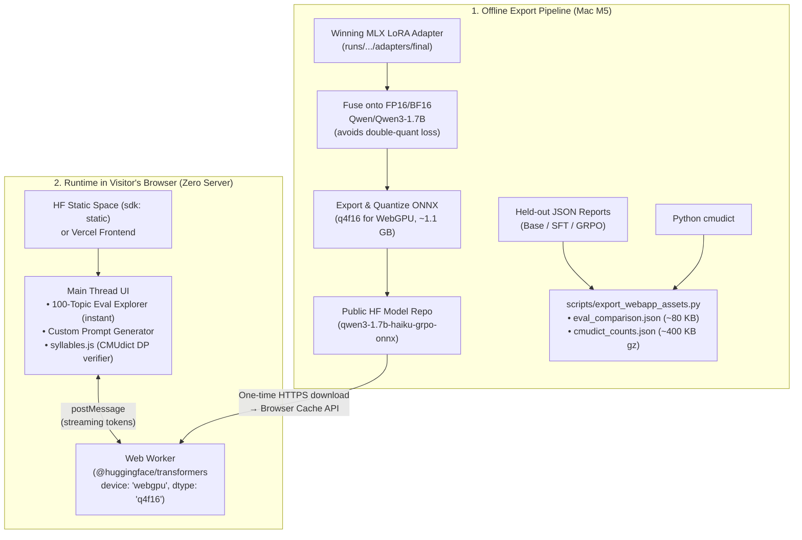

# Plan: Static WebGPU Haiku Showcase Web App (Base vs. GRPO LoRA)

## Goal

Build a zero-backend, \$0-forever web app hosted on a **Hugging Face Static Space** (`sdk: static` — and identically deployable to **Vercel**) that lets anyone:

1. **Explore real held-out results immediately (0 ms wait, works on mobile & every browser):** Interactive side-by-side comparison of **Base (`Qwen3-1.7B`) vs. SFT vs. GRPO** across all **100 unseen held-out topics** from [`data/eval.jsonl`](../data/eval.jsonl), complete with per-line `[5] [7] [5]` syllable pills, semantic relevance scores, and training progression stats.
2. **Generate live haikus on any custom topic directly in their browser (WebGPU):** Run our fine-tuned **GRPO `Qwen3-1.7B`** (and optionally the untouched **Base `Qwen3-1.7B`** side-by-side) locally on the visitor's own GPU using **`@huggingface/transformers` (ONNX Runtime Web)**, with live client-side **CMUdict phonetic 5-7-5 verification**.

---

## Architecture Overview

No backend server, no GPU quotas, and no cold-start sleep timeouts. The Static Space (or Vercel) serves only lightweight HTML/CSS/JS + compact JSON assets; the visitor's browser fetches quantized ONNX weights directly from **Hugging Face Hub CDN** and caches them locally in browser storage (`Cache API` / IndexedDB).



---

## Key UX & Engineering Design Decisions

### 1. Progressive Model Loading (Avoids 2.2 GB Upfront Wall)
Because browser ONNX runtimes cannot hot-swap a LoRA adapter onto a shared base graph yet, side-by-side live comparison uses two quantized models (**~1.1 GB** fine-tuned + **~1.1 GB** base). To keep the UX snappy and prevent browser OOM:

- **On page load (0 MB downloaded):** The 100-topic **Held-Out Explorer** is immediately interactive.
- **Click "Enable Live Generator" (~1.1 GB, ~15–30s on gigabit wired, cached afterward):** Downloads and loads **only the fine-tuned GRPO model first**, with a per-file progress bar (`progress_callback`). Users can immediately type topics and generate verified haikus.
- **Toggle "Compare vs. Base Model" (lazy +1.1 GB):** Loads the untouched Base ONNX model on demand.
  - **Memory-safe mode (default for `<= 16 GB` devices):** Keeps one active WebGPU pipeline at a time or runs **Fine-Tuned → Base** sequentially if memory pressure is detected, releasing GPU buffers between swaps so tabs don't crash.
  - **Side-by-side parallel mode (opt-in on high-VRAM desktops):** Keeps both models resident for instant dual generation.
- **Graceful fallback:** Checks `navigator.gpu` at startup. On mobile devices or browsers without WebGPU, disables the live WebGPU button with a friendly note while keeping the entire 100-topic Base vs. GRPO explorer + interactive CMUdict syllable checker fully functional.

### 2. Exact Prompt & Verifier Parity
- **Chat template parity:** Must use the exact `enable_thinking=False` Qwen3 prompt template used in [`src/grpo_haiku/data.py`](../src/grpo_haiku/data.py) (`"Craft a haiku about <topic>."` with empty `<think>\n\n</think>\n\n` assistant prefill or `enable_thinking: false`), `max_new_tokens: 48–64`, `temperature: 0.7` (or greedy `do_sample: false` toggle to match held-out eval).
- **CMUdict phonetic parity:** Port [`src/grpo_haiku/syllables.py`](../src/grpo_haiku/syllables.py) directly to `web/syllables.js`—including multi-pronunciation dynamic programming (e.g., *fire* ∈ {1, 2}), contraction/possessive stripping, hyphenated compounds, and strict OOV flagging—backed by a pre-compressed `cmudict_counts.json` (~350–450 KB gzipped) containing only `word -> [unique_counts]`.

---

## Implementation Plan (4 Phases)

### Phase 1: Model Fuse & WebGPU ONNX Export
1. **Fuse winning MLX LoRA adapter cleanly (no double-quantization):**
   - Write `scripts/fuse_to_hf.py` (or use `mlx_lm.fuse --de-quantize`) to apply the trained full-depth LoRA deltas (`lora_a`, `lora_b`, `scale=8.0` across all 28 layers, attention + MLP) onto full-precision `Qwen/Qwen3-1.7B` weights, saving a standard Hugging Face safetensors directory.
   - Sanity-check fused weights against the MLX adapter on 5 held-out prompts (greedy decode) to confirm matching outputs and 5-7-5 counts.
2. **Export to WebGPU-ready ONNX (`q4f16`):**
   - Convert the fused fine-tuned model (and untouched `Qwen/Qwen3-1.7B` base model with identical settings so Base vs. GRPO is strictly apples-to-apples) to `onnx` with `task="text-generation-with-past"` and `q4f16` quantization.
   - Verify with ONNX Runtime on 10 held-out prompts that exact 5-7-5 rate and formatting match the MLX checkpoint closely.
3. **Upload to Hugging Face Hub:**
   - Push fine-tuned ONNX repo: `<hf-user>/qwen3-1.7b-haiku-grpo-onnx`
   - Push (or reference) base ONNX repo: `<hf-user>/qwen3-1.7b-base-onnx`
   - Verify both repos serve cleanly with CORS enabled for browser fetches.

### Phase 2: Static Asset & Verifier Export
1. **Create `scripts/export_webapp_assets.py`:**
   - Generates `web/assets/cmudict_counts.json`: maps each lowercase CMUdict word to its sorted unique syllable counts (e.g., `"fire": [1, 2]`, `"every": [2, 3]`, `"pond": [1]`).
   - Generates `web/assets/eval_comparison.json`: merges `runs/baseline_direct_eval.json`, winning SFT eval, and winning GRPO eval across all 100 unseen topics (topic, domain, completion, line counts, `is_exact_575`, relevance similarity, summary metrics).
2. **Implement `web/syllables.js`:**
   - Pure ES module porting `tokenize_words`, `word_syllable_options`, `analyze_line`, and 5-7-5 verification from [`src/grpo_haiku/syllables.py`](../src/grpo_haiku/syllables.py).
   - Add a parity check script/test verifying **100.0% agreement** between `syllables.js` (run via Node) and Python `syllables.py` across all 100 held-out completions in `eval_comparison.json`.

### Phase 3: Static Web App (`web/`)
Build a clean, dependency-light static app (plain ES modules + CSS, or minimal Vite bundle) under `web/`:

```text
web/
├── README.md                 # HF Static Space YAML frontmatter (sdk: static)
├── index.html                # Single-page layout (Hero, Live WebGPU, 100-Topic Explorer)
├── styles.css                # Clean editorial typography, syllable pills, dark/light support
├── app.js                    # UI state, explorer filters, worker bridge, live verification
├── worker.js                 # Dedicated Web Worker for @huggingface/transformers WebGPU
├── syllables.js              # Pure-JS CMUdict DP phonetic syllable verifier
└── assets/
    ├── cmudict_counts.json   # Compact word -> [syllable counts] lookup (~400 KB gz)
    └── eval_comparison.json  # 100 unseen held-out Base vs. SFT vs. GRPO results
```

**UI Sections:**
1. **Header & Research Snapshot:** Headline Base → SFT → GRPO numbers (`exact_575_rate`, per-line `5 / 7 / 5` accuracy, `distinct_2`, `unique_haiku_ratio`), plus link back to the GitHub repo / README research report.
2. **Live In-Browser Generator (WebGPU):**
   - Topic input + quick-pick unseen topic chips + temperature/greedy toggle.
   - Progressive loader button + real-time download progress bar (with *"Cached locally after first download"* notice).
   - Side-by-side output cards (**GRPO Fine-Tuned** vs. optional **Base Qwen3-1.7B**) showing streaming text, live per-line syllable pills (`[5]` green / `[6]` amber), `EXACT 5-7-5` badge, OOV warning if any, and tokens/sec readout.
3. **100-Topic Held-Out Explorer (Instant, No Download):**
   - Filter by domain (all 10 domains), search by keyword, or filter to *"GRPO fixed Base miss"* / *"Exact 5-7-5 only"*.
   - Side-by-side cards showing exact Base vs. SFT vs. GRPO outputs on the same unseen prompt with syllable counts and cosine relevance.

### Phase 4: Verification & Deployment
1. **Local browser testing (`python3 -m http.server` inside `web/`):**
   - Verify 0ms load for the 100-topic explorer with zero network errors.
   - Verify WebGPU model load, streaming generation, live CMUdict verification, cached reload (~2–4s), and Base toggle without OOM.
   - Verify graceful fallback when `navigator.gpu` is unavailable (e.g., Firefox/mobile simulation).
2. **Deploy to Hugging Face Static Space:**
   - Create a new Space on Hugging Face with SDK = **Static** (`sdk: static` in `web/README.md`).
   - Push `web/` contents to the Space git remote.
   - *(Optional)* Point a **Vercel** project at `web/` for a custom domain—identical bundle, zero model weights in Git/Vercel, still fetching ONNX weights directly from HF Hub CDN.

---

## Verification Checklist Before Publishing

- [ ] `syllables.js` matches `src/grpo_haiku/syllables.py` on **100 / 100** held-out poems (0 line-count mismatches, 0 OOV mismatches).
- [ ] Fused ONNX `q4f16` model produces valid 3-line direct haikus (`enable_thinking=False`, zero `<think>` leakage) with held-out `exact_575_rate` closely matching the MLX checkpoint.
- [ ] Initial page load (`index.html` + JS + JSON assets) is `< 1 MB` compressed and fully interactive before any model download starts.
- [ ] Fine-tuned model loads first (~1.1 GB) with accurate progress reporting; Base comparison loads lazily without crashing a 16 GB browser tab.
- [ ] Non-WebGPU browsers gracefully show the 100-topic explorer and clear status message instead of throwing errors.
